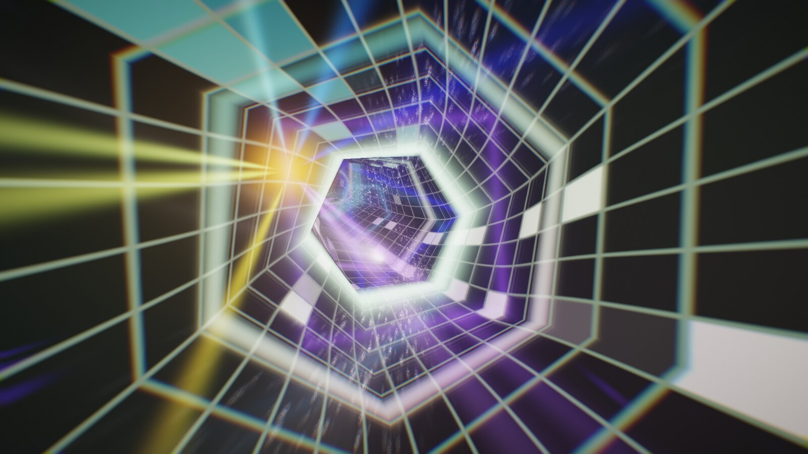
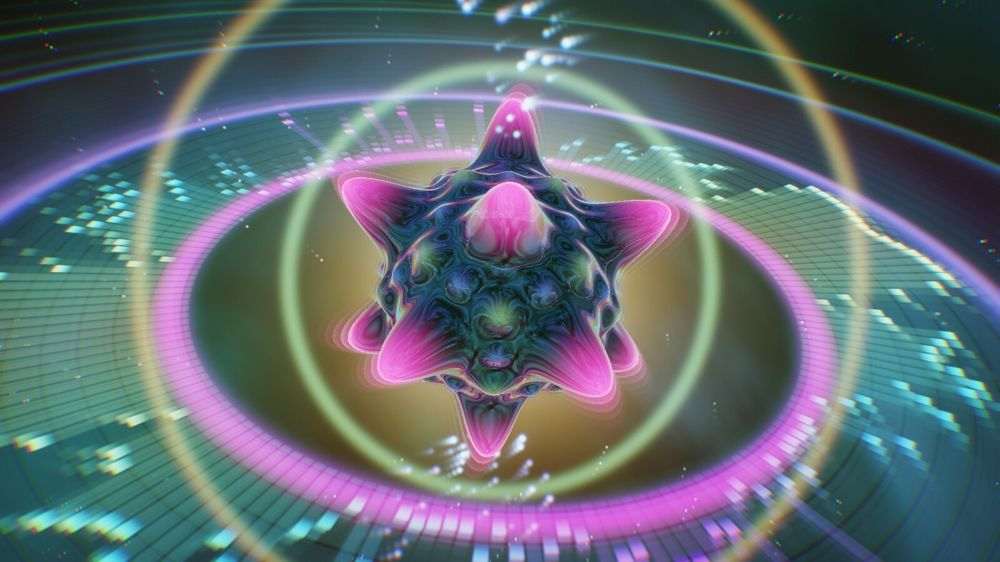
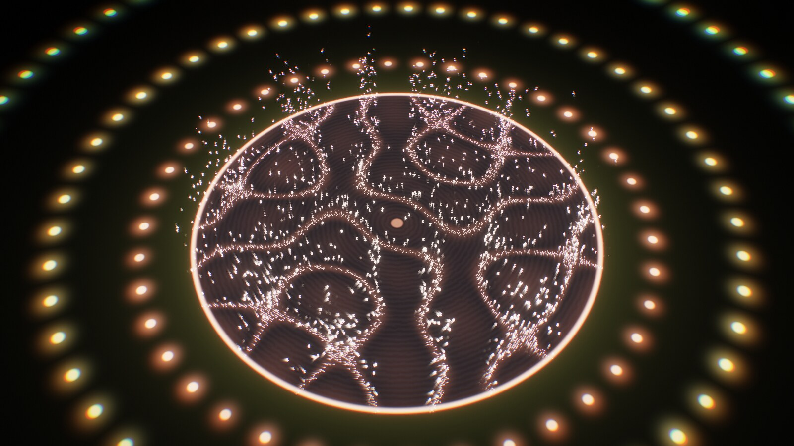
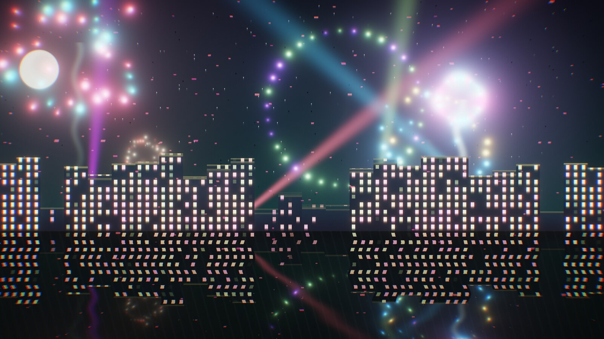
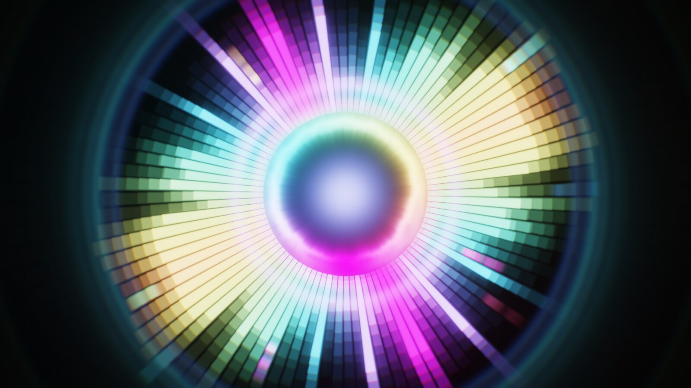
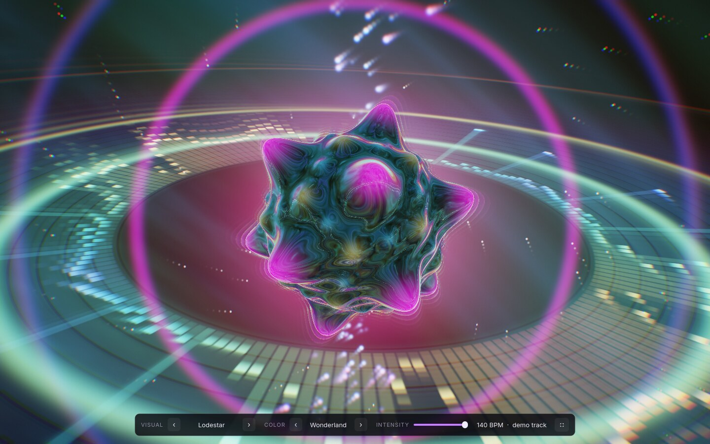

# Cuniculus

A music visualizer for whatever your system is playing, inspired by the rabbit-hole
tunnel from Sonique. *Cuniculus* is Latin for rabbit and for burrow.

- Listens to system output through PipeWire. No player, no setup.
- Five visualizers, made to feel the music: they react to the kick, the pitch and how big the
  moment is (a breakdown looks calm, a drop goes all out), not just to loudness.

| | |
|---|---|
|  |  |
|  |  |

*Screenshots are from the built-in demo track, at its drop.*

## Visualizers

- **Rabbit Hole**: a twisting neon tunnel. Wall panels are the spectrum, floating rings follow
  the mids, glitter follows the highs, and light trails weave down the middle. Every kick fires
  a ring of light ahead of you, surges the speed and steps the colours; the tunnel changes
  shape every 16 kicks, and a laser fan opens up when the track is at full energy.
- **Lodestar**: a liquid-metal star with three families of spikes, one each for bass, mids and
  highs, so a kick visibly punches the big spikes out. A spectrum disk turns with the tempo,
  every kick sends out a ring and a shock shell, and particle streams open from the poles at full energy.
- **Cymatica**: glowing sand on a vibrating Chladni plate. The pattern follows the pitch of the
  music: low sounds make a few big shapes, higher sounds make finer lattices, and as the pitch
  slides the lines morph from one figure to the next. Every bass hit tosses grains of sand
  into the air. Rings of LEDs around the plate act as a level meter with depth: the outer
  rings only light in a loud, intense part, and every kick sends a pulse out through them.
- **Fiesta**: fireworks over a city and a lake. Every kick explodes a shell (rings, hearts,
  stars, willows), snares pop crackles, the skyline is the spectrum, the highs rain confetti,
  and searchlights sweep when the track is at full energy.
- **Nova**: a radial spectrum burst that turns with the tempo and sends a ring out on every
  kick. Also the small example plugin to copy.

Visualizers are plugins: a folder with one shader file. See [PLUGINS.md](PLUGINS.md) to write your own.

## Run

    ./run.sh            # system audio
    ./run.sh --demo     # built-in silent demo track (breakdown, build, drop), no sound needed
    ./run.sh --demo --demo-at 27   # start the demo at its drop (0 breakdown, 15 build, 52 outro)
    ./install.sh        # adds Cuniculus to the app launcher (no sudo)

## Requirements

- **PipeWire** with the `pw-record` command (default on Fedora, Ubuntu 22.10+, Debian 12+, Arch).
  Audio capture is built on it, so PulseAudio-only systems will not work.
- **Python 3.9+**, **PyQt6** (with its OpenGL widget) and **numpy**. On Arch: `python-pyqt6`,
  `python-numpy`. Other distros name these differently, and PyQt6 is sometimes only on pip.
- **A GPU and driver with OpenGL 4.1 core** and 16-bit float render targets. Any AMD, Nvidia or
  Intel GPU from roughly the last 10 years qualifies.
- X11 or Wayland, any desktop. There is no desktop-specific code.

**Tested on:** CachyOS, KDE Plasma on Wayland, AMD RX 9070 XT. Other setups should work but
have not been tried. The heavier visualizers (Rabbit Hole, Lodestar) are tuned for a strong GPU
and will run slower on a modest one.

There is no distro package yet; for now clone the folder and run `./run.sh`.

## Controls

Move the mouse to show the control strip; it hides itself after a couple of seconds.

| Key | Action |
|---|---|
| F11, F, double-click | fullscreen |
| Left / Right | previous / next visualizer |
| P / Shift+P | next / previous colour palette |
| R | rescan plugins |
| Q | quit |
